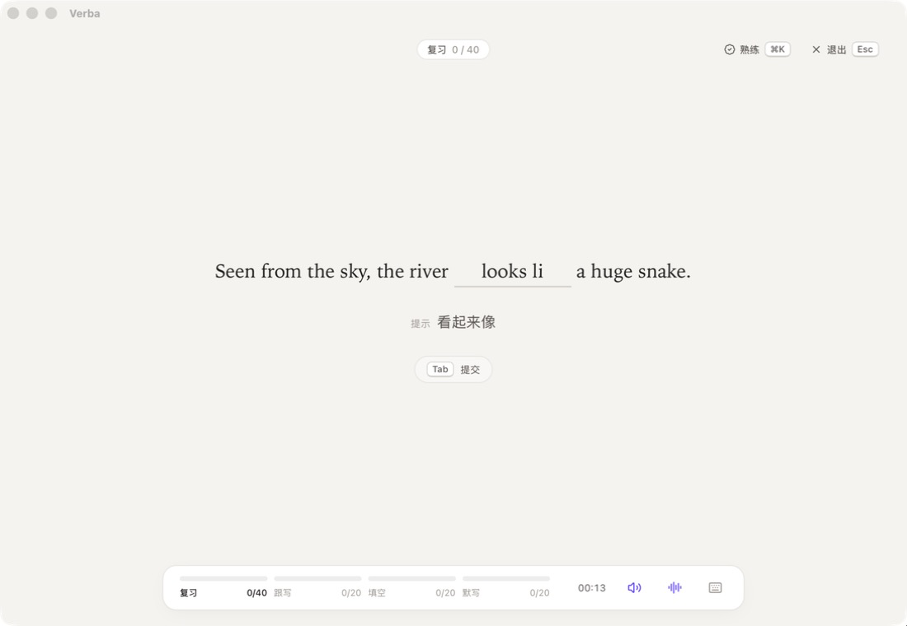

# Verba

打字背英文短语的桌面应用。

[](https://github.com/stardustlil/verba/actions/workflows/ci.yml)


单词背得再多，写作和口语里还是凑不出地道的说法；真正好用的是成块的表达，比如 _take advantage of_、_in terms of_。Verba 把短语放进真实例句里，让你一个字母一个字母地打出来，再按间隔重复安排复习。免费、开源、无账号，数据只存在本机。


## 功能

- **原位打字**：一轮按 复习 → 跟写 → 语境填空 → 纯中文默写 进行，字母直接打在题目上，写对自动判对
- **自动排期**：基于 [FSRS](https://github.com/open-spaced-repetition/ts-fsrs)，按你的作答自动评级、安排复习，不用自己打分
- **宽容的判分**：大小写、标点、英美拼写、缩写、人称代词都按等价处理
- **内置词书**：动词短语、介词短语与固定表达、写作搭配，共约 1800 条，按真实语料频率排序，每条都有例句和翻译
- **从文章里学**：导入英文文章、网址或 txt / md 文件，由 AI 抽取短语（兼容 OpenAI 格式的服务），也可以手动添加
- **其他**：标记熟练、额外练习、练习热图、朗读与打字音效、亮色 / 暗色主题

<table>
  <tr>
    <td width="50%"></td>
    <td width="50%"></td>
  </tr>
</table>

## 安装

从 [GitHub Actions](https://github.com/stardustlil/verba/actions/workflows/ci.yml) 的构建产物下载安装包（macOS `.dmg`，Windows `.msi` / `.exe`，Linux `.deb` / `.rpm` / `.AppImage`）。

安装包没有代码签名。macOS 第一次打开被拦截时，到“系统设置 → 隐私与安全性”点“仍要打开”；Windows 在 SmartScreen 提示中点“更多信息 → 仍要运行”。

## 使用

在首页按 <kbd>空格</kbd> 开始学习，练习全程只用键盘：

| 快捷键                      | 作用                   |
| --------------------------- | ---------------------- |
| <kbd>空格</kbd>             | 下一题                 |
| <kbd>Tab</kbd>              | 提交；还没写时看答案   |
| <kbd>Cmd/Ctrl + Enter</kbd> | 我写的也对             |
| <kbd>Cmd/Ctrl + K</kbd>     | 标记熟练，跳过这个短语 |
| <kbd>Cmd/Ctrl + D</kbd>     | 删除短语               |
| <kbd>Cmd/Ctrl + Z</kbd>     | 撤销删除或熟练标记     |
| <kbd>Esc</kbd>              | 结束本轮               |

完整的规则和快捷键见应用里的“说明”页。

## 开发

需要 Node.js 22+、Rust stable 和 [Tauri 的系统依赖](https://tauri.app/start/prerequisites/)。

```bash
npm install
npm run tauri dev     # 开发
npm test              # 单元测试
npm run tauri build   # 构建安装包
```

业务规则（判分、评级、复习调度）都在 `src/core`，是带单元测试的纯函数；Rust 端只负责 SQLite、网络请求和保管 API key。内置词书由 [scripts/books](scripts/books/README.md) 生成。

## 致谢

交互参考了 [TypeWords](https://github.com/zyronon/TypeWords)（只借鉴思路，未使用代码）。复习调度使用 [FSRS](https://github.com/open-spaced-repetition)；词书数据来自 [ECDICT](https://github.com/skywind3000/ECDICT) 和 [Tatoeba](https://tatoeba.org)；英美拼写数据来自 [VarCon](https://github.com/en-wl/wordlist)。

## 许可证

代码以 [MIT](LICENSE) 许可发布。词书中取自 Tatoeba 的例句遵循 CC BY 2.0 FR，详见 [SOURCES.md](src/data/books/SOURCES.md)；拼写数据的许可见 [SPELLING-DATA-LICENSE.txt](src/core/judge/SPELLING-DATA-LICENSE.txt)。
